# 토독(Todok) 백엔드 통합 ERD (v1.0)

> **작성일**: 2026-11-28
> **작성자**: 개발자 2 (개발자 1 신서현 ERD + 개발자 2 박나현 ERD 통합)
> **기준 문서**: MoSCoW v4.0 · PRD v4.0 · IA+Depth v3.0 · FlowChart v3.0 · API 명세서 v1.0
> **DBMS**: PostgreSQL / 시간 = `TIMESTAMPTZ`(서버 표준시각) / enum = `VARCHAR + CHECK`
> **상태**: 통합 1차 — 교차 리뷰 반영본. 함께 보는 파일: `통합schema_v1.0_11-28.sql`

---

## 0. 통합 시 내린 결정 (교차 리뷰 "맞춰야 할 것" 확정)

양쪽 ERD의 미결·조율 항목을 아래와 같이 **더 나은 방향으로 확정**했다. 근거를 함께 적는다.

| # | 항목 | 확정 | 근거 |
| --- | --- | --- | --- |
| D-1 | PK 타입 | 내부 PK는 전 테이블 `BIGSERIAL` 통일 | 조인·인덱스 효율, 개발자 1 설계와 일치 |
| D-2 | 노출 자원 식별자 | 외부로 id가 나가는 콘텐츠 테이블(`readings`·`letters`·`letter_requests`)에 `public_id UUID UNIQUE` 추가, API 경로/응답은 UUID 사용. **`readings` 적용 유지 확정** — 개발자 1 소유 테이블이므로 11/28 교차 리뷰에서 공유 | 순번 id 노출 시 음성 콘텐츠 열거·스크래핑 위험(S-02 스트리밍 전용·보안 원칙). 내부 FK는 BIGINT 유지로 성능 보존 |
| D-3 | enum 저장 | `VARCHAR + CHECK` | 운영 중 값 추가가 잦음(상태·사유), PG ENUM은 변경 비용 큼 |
| D-4 | STT 처리 | 개발자 1 `stt_jobs` **공용 테이블 재사용**(`target_type=LETTER`). 결과 텍스트는 대상의 `stt_text`에만 저장 | 보관 최소화 원칙, 낭독·편지 파이프라인 단일화(Phase 2 초반 공통 인터페이스 의존성 해소) |
| D-5 | 검수 큐의 STT | `review_queue`에서 `stt_text` 컬럼 **제거**, `filter_result`(금지어·원문대조·무음)만 보유. 운영자 화면은 대상의 `stt_text`를 조인해 표시 | D-4와 일관, STT 글자 이중 저장 방지 |
| D-6 | 다형 참조 패턴 | `reactions`·`reports`·`stt_jobs`·`review_queue` 모두 `(target_type, target_id)` + 앱 레벨 무결성 + `(target_type, target_id)` 인덱스 | 낭독·편지 공용 로직 통일, 양쪽 이미 같은 패턴 채택 |
| D-7 | 응원 반응 | 개발자 1 `reactions` **공용 1테이블**을 편지도 사용(별도 편지 반응 테이블 없음) | `UNIQUE(user_id, target_type, target_id)`로 중복 방지, C-09 내부용 |
| D-8 | 제재 보존 vs 탈퇴 | `sanctions`는 탈퇴해도 보존(users에 `ON DELETE` cascade 미적용, `user_id`는 논리 참조). 개발자 1 탈퇴 로직이 활성 `UPLOAD_BLOCK`을 읽어 `withdrawn_users.retain_until`에 반영 | 재가입 제재 회피 확인(withdrawn_users 목적)과 결합, 도메인 간 결합도 최소화 |
| D-9 | "내가 신고한 대상 제외" | 개발자 2 `reports`의 `UNIQUE(reporter_id, target_type, target_id)`(reporter_id 선두) 인덱스를 개발자 1 피드 쿼리가 그대로 사용 | 추가 인덱스 불필요, 양쪽 합의 |
| D-10 | 서버 작업 실행 위치 | 재시도성 작업(탈퇴·S3·FCM·unlink)은 개발자 1 `job_queue`. 주기성 배치(편지 마감·0통 삭제·24h 소멸·5개 소각)는 서버 스케줄러가 각 도메인 테이블을 `FOR UPDATE SKIP LOCKED`로 스캔 | 계획서 "서버 내 스케줄러 + DB 작업 표" 방침 |

---

## 1. 전체 ERD

```mermaid
erDiagram
    %% ===== 개발자 1: 회원·인증·낭독 =====
    users ||--o{ consents : ""
    users ||--o{ refresh_tokens : ""
    users ||--o{ push_tokens : ""
    users ||--|| notification_settings : ""
    users ||--o{ readings : ""
    users ||--o{ reactions : ""
    users ||--o{ reading_bookmarks : ""
    policies ||--o{ consents : ""
    passages ||--o{ readings : ""
    readings ||--o{ reading_bookmarks : ""

    %% ===== 개발자 2: 편지·운영자 =====
    users ||--o{ letter_requests : "requester"
    users ||--o{ letters : "sender"
    users ||--o{ mailbox : "recipient"
    users ||--o{ letter_bookmarks : ""
    users ||--o{ reports : "reporter"
    users ||--o{ sanctions : "subject (no cascade)"
    letter_requests ||--o{ letters : ""
    stamps ||--o{ letters : ""
    letters ||--|| mailbox : ""
    letters ||--o{ letter_bookmarks : ""
    reports }o--|| sanctions : "actioned"

    %% ===== 공용 (다형 참조: READING | LETTER) =====
    readings ||..o{ reactions : "target"
    letters ||..o{ reactions : "target"
    readings ||..o{ reports : "target"
    letters ||..o{ reports : "target"
    readings ||..o{ stt_jobs : "target"
    letters ||..o{ stt_jobs : "target"
    letter_requests ||..o{ review_queue : "REQUEST"
    readings ||..o{ review_queue : "READING"
    letters ||..o{ review_queue : "LETTER"

    users {
        bigint id PK
        bigint kakao_id UK "탈퇴 시 해시 대체"
        varchar nickname "UNIQUE(lower)"
        varchar avatar_code
        timestamptz profile_completed_at
        varchar invite_code UK "Should P-05"
        timestamptz last_login_at
    }
    policies {
        bigint id PK
        varchar type "TERMS|PRIVACY|MARKETING"
        varchar version
        boolean is_required
        boolean is_current
        timestamptz effective_at
    }
    consents {
        bigint id PK
        bigint user_id FK
        bigint policy_id FK
        boolean agreed
        timestamptz agreed_at
    }
    refresh_tokens {
        bigint id PK
        bigint user_id FK
        uuid family_id "재사용 감지 시 family 폐기"
        varchar token_hash UK "SHA-256"
        varchar device_id
        timestamptz expires_at
        timestamptz revoked_at
    }
    passages {
        bigint id PK
        varchar text
        varchar category
        varchar mood
        int max_record_sec
        boolean is_active
    }
    readings {
        bigint id PK
        uuid public_id UK "D-2 신규"
        bigint user_id FK
        bigint passage_id FK
        varchar audio_key
        int duration_sec
        text stt_text "폴백 시 NULL"
        varchar status "REVIEWING|PUBLISHED|REJECTED|WITHDRAWN"
        boolean is_hidden "3인 신고 임시비공개"
        varchar reject_reason_code
        timestamptz published_at
        timestamptz deleted_at
    }
    reactions {
        bigint id PK
        bigint user_id FK
        varchar target_type "READING|LETTER"
        bigint target_id
        varchar reaction_type
    }
    reading_bookmarks {
        bigint id PK
        bigint user_id FK
        bigint reading_id FK
    }
    stt_jobs {
        bigint id PK
        varchar target_type "READING|LETTER"
        bigint target_id
        varchar status "PENDING|RUNNING|DONE|FAILED"
        int attempt_count "<=3"
        timestamptz next_run_at
        timestamptz locked_at
        varchar rtzr_job_id
        varchar error_code
    }
    push_tokens {
        bigint id PK
        bigint user_id FK
        varchar token UK
        varchar platform "ANDROID"
        boolean is_active
    }
    notification_settings {
        bigint user_id PK
        boolean reaction_enabled
        boolean letter_enabled
        boolean notice_enabled
    }
    withdrawn_users {
        bigint id PK
        varchar kakao_hash UK
        timestamptz withdrawn_at
        timestamptz retain_until "활성 제재 반영"
    }
    job_queue {
        bigint id PK
        varchar job_type
        jsonb payload
        varchar status
        timestamptz run_at
        int attempts
        timestamptz locked_at
        varchar last_error
    }

    letter_requests {
        bigint id PK
        uuid public_id UK "D-2 신규"
        bigint requester_id FK
        varchar title "<=10"
        varchar content "<=50"
        varchar status "REVIEWING|PUBLISHED|REJECTED|CLOSING|CLOSED|EXPIRED"
        int letter_count "internal C-09"
        timestamptz published_at
        timestamptz expires_at "published+24h"
        timestamptz deleted_at "L-09 soft"
    }
    letters {
        bigint id PK
        uuid public_id UK "D-2 신규"
        bigint sender_id FK
        bigint request_id FK
        bigint stamp_id FK
        varchar audio_key
        int duration_sec "<=30"
        text stt_text
        varchar status "REVIEWING|PUBLISHED|REJECTED|WITHDRAWN"
        timestamptz submitted_at "L-04 기준"
        timestamptz delivered_at
    }
    mailbox {
        bigint id PK
        bigint recipient_id FK
        bigint letter_id FK "UNIQUE"
        varchar status "UNREAD|READ|BURNED|EXPIRED"
        timestamptz opened_at
        timestamptz expires_at "opened+24h"
        timestamptz created_at "arrival"
    }
    stamps {
        bigint id PK
        varchar name
        varchar image_key
        boolean is_active
        int sort_order
    }
    letter_bookmarks {
        bigint id PK
        bigint user_id FK
        bigint letter_id FK
        varchar direction "RECEIVED|SENT"
    }
    reports {
        bigint id PK
        bigint reporter_id FK
        varchar target_type "READING|LETTER"
        bigint target_id
        varchar reason_code
        varchar status "PENDING|RESOLVED"
        varchar resolution "NO_ISSUE|ACTIONED"
        bigint resolved_by
    }
    sanctions {
        bigint id PK
        bigint user_id "논리참조 no-cascade D-8"
        varchar level "WITHDRAW|WARNING|UPLOAD_BLOCK"
        bigint report_id FK
        timestamptz starts_at
        timestamptz ends_at "7d 해제"
    }
    banned_words {
        bigint id PK
        varchar pattern
        varchar type "WORD|PHISHING"
        boolean is_regex
    }
    settings {
        varchar key PK
        varchar value
        varchar value_type
    }
    review_queue {
        bigint id PK
        varchar target_type "REQUEST|READING|LETTER"
        bigint target_id
        varchar queue_type "TEXT|VOICE"
        varchar status "PENDING|APPROVED|REJECTED"
        jsonb filter_result "STT는 대상 stt_text 조인 D-5"
        bigint assigned_admin_id
        timestamptz created_at "대기시간 지표"
    }
```

---

## 2. 개발자 1 — 회원 · 인증 · 낭독 (소유)

> 상세 정의는 개발자 1 페이지 기준. 여기서는 통합 관점의 핵심과 D-2(public_id) 추가분만 표기.

### 2-1. `users`
`id` PK · `kakao_id` BIGINT UNIQUE(탈퇴 시 해시 대체) · `nickname` VARCHAR(10) `UNIQUE(lower(nickname))`(온보딩 전 NULL) · `avatar_code` · `profile_completed_at`(NULL=온보딩 미완) · `invite_code` UNIQUE(Should) · `last_login_at` · `created_at` · `updated_at`

### 2-2. `policies` / `consents`
- `policies`: `type`(TERMS/PRIVACY/MARKETING) · `version` `UNIQUE(type,version)` · `title` · `content` · `is_required` · `is_current`(type당 1개, 부분 유니크) · `effective_at`. **운영자 약관 버전 API(개발자 2 `/admin/policies`)가 INSERT** → `is_current` 전환 규칙 준수.
- `consents`: `user_id` · `policy_id` `UNIQUE(user_id,policy_id)` · `agreed` · `agreed_at`.

### 2-3. `refresh_tokens`
`family_id` UUID(로그인 1회=family 1개, 재사용 감지 시 family 전체 폐기) · `token_hash` UNIQUE(SHA-256) · `device_id` · `expires_at` · `used_at` · `revoked_at`.

### 2-4. `passages`
`text` · `category` · `mood`(`/meta/filters` 두 축) · `max_record_sec`(없으면 `settings` 기본값) · `is_active`. 운영자 A-06 등록.

### 2-5. `readings` (+ D-2)
`public_id` **UUID UNIQUE(신규)** · `user_id` · `passage_id` · `audio_key` · `duration_sec`(재생 URL 만료 계산) · `stt_text`(폴백 NULL) · `status`(REVIEWING/PUBLISHED/REJECTED/WITHDRAWN) · `is_hidden`(3인 신고 임시 비공개) · `reject_reason_code` · `published_at` · `created_at` · `deleted_at`.

### 2-6. 공용 · 보조
- `reactions`(공용): `(target_type, target_id)` · `reaction_type` · `UNIQUE(user_id,target_type,target_id)`. **편지도 이 테이블 사용(D-7)**. 수는 내부용(C-09).
- `reading_bookmarks`(Should): `UNIQUE(user_id,reading_id)`.
- `stt_jobs`(공용): `(target_type, target_id)` · `status`(PENDING/RUNNING/DONE/FAILED) · `attempt_count`(≤3) · `next_run_at` · `locked_at`(`FOR UPDATE SKIP LOCKED`) · `rtzr_job_id` · `error_code`. 결과는 대상 `stt_text`에만 저장. **편지 STT가 재사용(D-4)**.
- `push_tokens`: `token` UNIQUE · `platform`(ANDROID) · `is_active`(UNREGISTERED 시 false).
- `notification_settings`: `user_id` PK · `reaction_enabled` · `letter_enabled` · `notice_enabled`.
- `withdrawn_users`: `kakao_hash` UNIQUE · `withdrawn_at` · `retain_until`(재가입 제재 회피 확인, **개발자 2 `sanctions` 활성분 반영 D-8**).
- `job_queue`(공용): `job_type` · `payload` jsonb · `status` · `run_at` · `attempts` · `locked_at` · `last_error`. 탈퇴 재시도 · S3 삭제 · FCM 재시도 · unlink 공용.

---

## 3. 개발자 2 — 편지 · 운영자 (소유)

### 3-1. `letter_requests` (+ D-2)
| 컬럼 | 타입 | 설명 |
| --- | --- | --- |
| `id` | BIGSERIAL PK | 내부 |
| `public_id` | UUID UNIQUE | **신규 D-2** — API 경로용 |
| `requester_id` | BIGINT FK users | 요청자 |
| `title` | VARCHAR(10) | 제목 (TEXT_TOO_LONG) |
| `content` | VARCHAR(50) | 듣고 싶은 말 |
| `status` | VARCHAR(16) | REVIEWING→PUBLISHED→CLOSING→CLOSED / REJECTED / EXPIRED |
| `letter_count` | INT | 내부용(C-09) |
| `published_at` / `expires_at` | TIMESTAMPTZ | 승인 시각 / +24h |
| `reject_reason` | VARCHAR | 안전 사유 |
| `deleted_at` | TIMESTAMPTZ | L-09 소프트 삭제 |

전이: `REVIEWING ─승인→ PUBLISHED ─24h→ CLOSING ─검수중 편지 없음→ CLOSED(1통+) / EXPIRED(0통)`. `REVIEWING ─반려→ REJECTED`.
규칙: 24h 쿨다운(REQUEST_COOLDOWN), 금지어·피싱 통과 시 `review_queue(TEXT)` 등록. 목록은 본인·신고분 제외.
인덱스: `(requester_id, created_at DESC)`, `(status, expires_at)`, `(status, published_at)`.

### 3-2. `letters` (+ D-2)
| 컬럼 | 타입 | 설명 |
| --- | --- | --- |
| `id` | BIGSERIAL PK | |
| `public_id` | UUID UNIQUE | **신규 D-2** |
| `sender_id` | BIGINT FK users | 발신자 |
| `request_id` | BIGINT FK letter_requests | 대상 요청 |
| `stamp_id` | BIGINT FK stamps | 우표 필수(STAMP_REQUIRED) |
| `audio_key` | VARCHAR | S3 비공개 키 |
| `duration_sec` | INT ≤30 | RECORDING_TOO_LONG |
| `stt_text` | TEXT | `stt_jobs` 결과 저장(D-4) |
| `status` | VARCHAR(16) | REVIEWING/PUBLISHED/REJECTED/WITHDRAWN |
| `submitted_at` | TIMESTAMPTZ | **L-04 마감 비교 기준** |
| `delivered_at` | TIMESTAMPTZ | 도착 시각 |

규칙: upload-url 발급 전 30초·하루 10통·게시중·제재 확인. 제출 시 `stt_jobs(target=LETTER)` 등록(D-4). 회수·삭제 시 `mailbox`·`letter_bookmarks`·`reactions` 연동 정리.
인덱스: `(sender_id, submitted_at)`, `(request_id, status)`, `(status)`.

### 3-3. `mailbox`
`recipient_id` FK users · `letter_id` FK letters UNIQUE · `status`(UNREAD/READ/BURNED/EXPIRED) · `opened_at` · `expires_at`(opened+24h) · `created_at`(도착) · `deleted_at`.
규칙: 안 읽은 최대 5개, 6번째 UNREAD 도착 시 가장 오래된 1개 삭제, 5개 도달 시 소각 알림 1회(L-07). open 시 24h 시작. 발신자 회수·탈퇴 시 행 삭제.
인덱스: `(recipient_id, status, created_at DESC)`, `(status, expires_at)`.

### 3-4. `stamps`
`name` · `image_key` · `is_active` · `sort_order`. `GET /stamps`는 active만 정렬. 관리 `/admin/stamps`.

### 3-5. `letter_bookmarks`
`user_id` · `letter_id` · `direction`(RECEIVED/SENT) · `created_at` · `UNIQUE(user_id, letter_id)`. 받은+보낸 합산 최대 30(BOOKMARK_FULL, 트랜잭션 교체). 인덱스 `(user_id, created_at DESC)`.

### 3-6. `reports`
`reporter_id` · `target_type`(READING/LETTER) · `target_id` · `reason_code` · `status`(PENDING/RESOLVED) · `resolution`(NO_ISSUE/ACTIONED) · `resolved_by` · `UNIQUE(reporter_id, target_type, target_id)`. 3인(DISTINCT reporter) 시 대상 `is_hidden`/임시 비공개(A-05). 인덱스 `(target_type, target_id)`, `(status, created_at)`. **D-9: reporter_id 선두 유니크로 피드 숨김 쿼리 공용**.

### 3-7. `sanctions` (D-8)
`user_id` BIGINT(논리 참조, **no cascade**) · `level`(WITHDRAW/WARNING/UPLOAD_BLOCK) · `report_id` FK reports · `reason` · `starts_at` · `ends_at`(7일 해제) · `created_by` · `created_at`. 누적 ACTIONED 횟수로 단계 산정. 탈퇴해도 보존, 개발자 1 탈퇴 로직이 활성 `UPLOAD_BLOCK`→`withdrawn_users.retain_until` 반영. 인덱스 `(user_id, ends_at)`.

### 3-8. `banned_words`
`pattern` · `type`(WORD/PHISHING) · `is_regex` · `created_by`. 닉네임·요청 사전검사·STT 점검에 사용(캐시 권장).

### 3-9. `settings` (초기 시드)
| key | value | 근거 |
| --- | --- | --- |
| `daily_upload_limit` | 5 | H-09 |
| `daily_letter_limit` | 10 | L-04 |
| `request_cooldown_hours` | 24 | L-02 |
| `letter_duration_sec` | 30 | 편지 녹음 |
| `unread_letter_max` | 5 | L-07 |
| `letter_bookmark_max` | 30 | L-10 |
| `opened_letter_ttl_hours` | 24 | L-06 |
| `request_publish_ttl_hours` | 24 | 요청 게시 |
| `expired_request_retention_days` | 7 | L-09(가정) |
| `request_closing_soon_hours` | (미정) | 마감 임박, L-03 디자인팀 |

카테고리별 글자 수·제한 시간은 `passages`(개발자 1)/운영 설정 공동 관리.

### 3-10. `review_queue` (D-5)
`target_type`(REQUEST/READING/LETTER) · `target_id` · `queue_type`(TEXT/VOICE) · `status`(PENDING/APPROVED/REJECTED) · `filter_result` jsonb(금지어·원문대조·무음) · `assigned_admin_id` · `decided_by` · `reject_reason` · `created_at`(대기시간 지표) · `decided_at`. **STT 글자는 대상 `stt_text` 조인 표시(중복 저장 안 함)**. 인덱스 `(queue_type, status, created_at)`, `(target_type, target_id)`.

---

## 4. 공용 · 도메인 간 접점

| 접점 | 개발자 1 | 개발자 2 | 통합 방식 |
| --- | --- | --- | --- |
| 응원 반응 | `reactions` 소유 | 편지 반응 | 공용 1테이블, `target_type=LETTER`(D-7) |
| STT | `stt_jobs` 소유, 파이프라인 구축 | 편지 STT 재사용 | `target_type=LETTER` 등록, 결과는 `letters.stt_text`(D-4) |
| 신고 숨김 | 피드에서 내 신고분 제외 | `reports` 소유 | `UNIQUE(reporter_id, ...)` 공용(D-9) |
| 푸시(FCM) | FCM 모듈·`push_tokens`·`job_queue` | 편지 도착·소각 이벤트 | 개발자 2는 이벤트만 발생, 발송은 개발자 1 모듈 |
| 탈퇴/제재 | 탈퇴 로직·`withdrawn_users` | `sanctions` | 탈퇴 시 활성 제재 읽어 `retain_until` 설정(D-8) |
| 약관 버전 | `policies` 소유 | `/admin/policies` INSERT | 개발자 2가 쓰고 개발자 1 테이블 규칙 준수 |
| 검수 큐 | `readings` 대상 제공 | `review_queue` 소유 | 음성 검수 A-02가 낭독 E2E 선행 의존 |
| 서비스 수치 | `passages.max_record_sec` 참조 | `settings` 소유 | 기본값은 `settings`, 문장별 예외는 `passages` |

---

## 5. 남은 미결 (팀 회의 확정 필요 — 스키마는 가정으로 동작 가능)

| 항목 | 현재 가정 | 확정 시 영향 |
| --- | --- | --- |
| L-04 마감 후 전달 | 제출≤마감이면 전달, `CLOSING` 보류 | `letters.submitted_at`, `letter_requests.status` |
| L-09 0통 알림 | 푸시 없음 + 7일 소프트 삭제 | `deleted_at`, `settings` |
| 마감 임박 기준 시간 | 미정 | `settings.request_closing_soon_hours` |
| STT 글자 보관 기간 | 검수·신고 종료 후 삭제 검토 | `readings`/`letters.stt_text` 정리 배치 |
| 제재 보존 기간 | 6개월~1년 | `withdrawn_users.retain_until` 산정식 |
| RTZR 약관·단가 | 확정 문구 미기재 | STT 방침 문구 |

---

## 6. 변경 이력
- v1.0 (11/28): 개발자 1 ERD + 개발자 2 ERD 통합, 교차 리뷰 결정 D-1~D-10 반영.
